<!-- Animated contribution graph: real data, refreshed daily by .github/workflows/update-profile-art.yml -->

<h3><code>peter@github ~ $ ./contributions.sh</code></h3>

 
 

<!-- ASCII portrait (left) + neofetch card (right). Both SVGs are 840x880, so equal widths give equal heights.
     Regenerate: python scripts/prep_photo.py && python scripts/make_ascii_svg.py && python scripts/make_info_card.py -->

<h3><code>peter@github ~ $ whoami</code></h3>

<table>
<tr>
<td valign="top"></td>
<td valign="top"></td>
</tr>
</table>

 
 

<h3><code>peter@github ~ $ ./links.sh</code></h3>

<b>Operations &amp; AI consulting · Hotel owner · AWS Solutions Architect</b>

 

